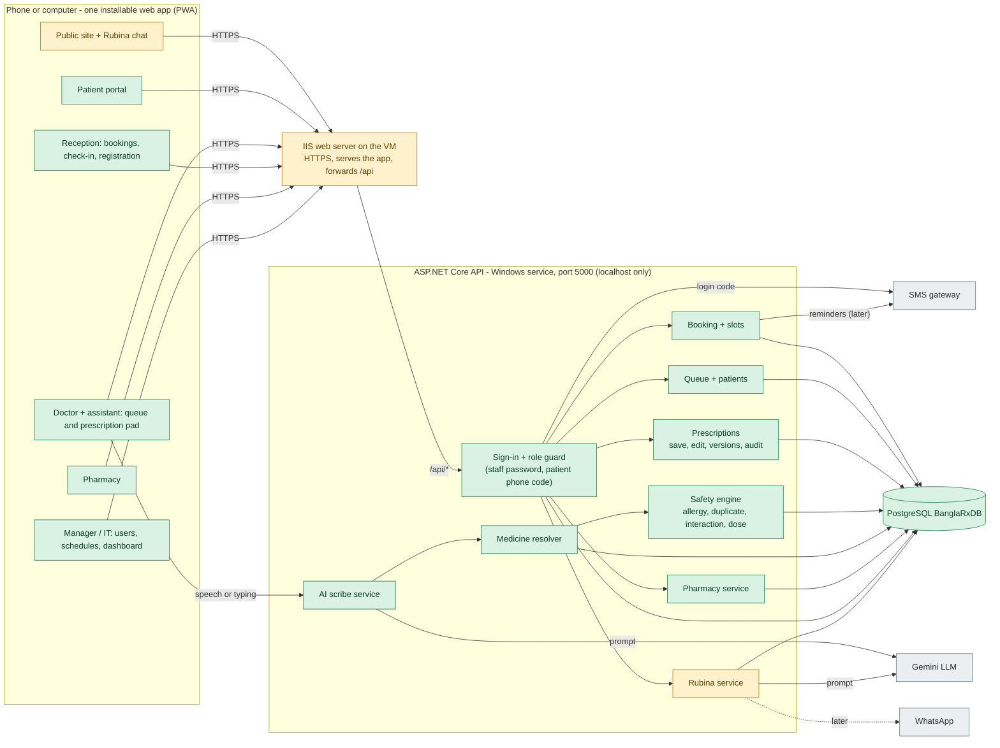
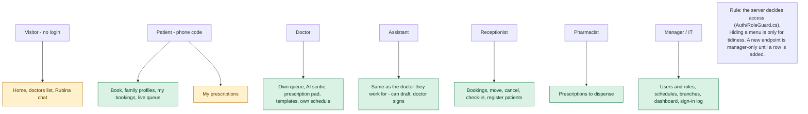
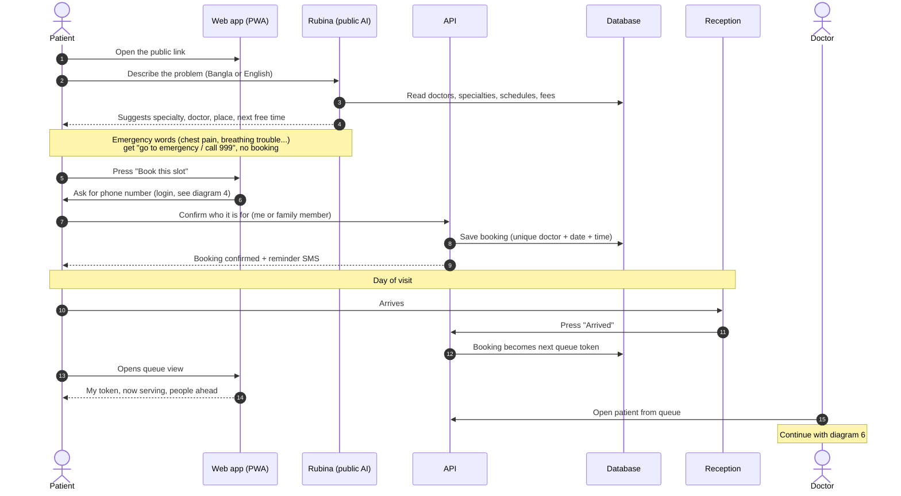
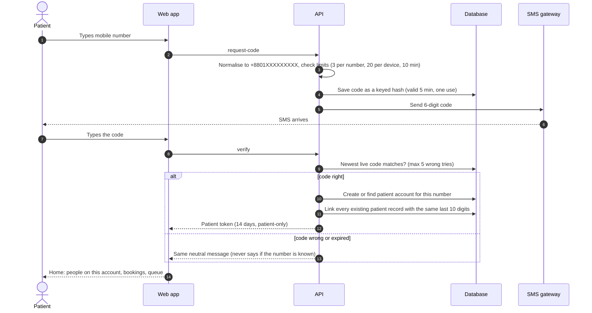
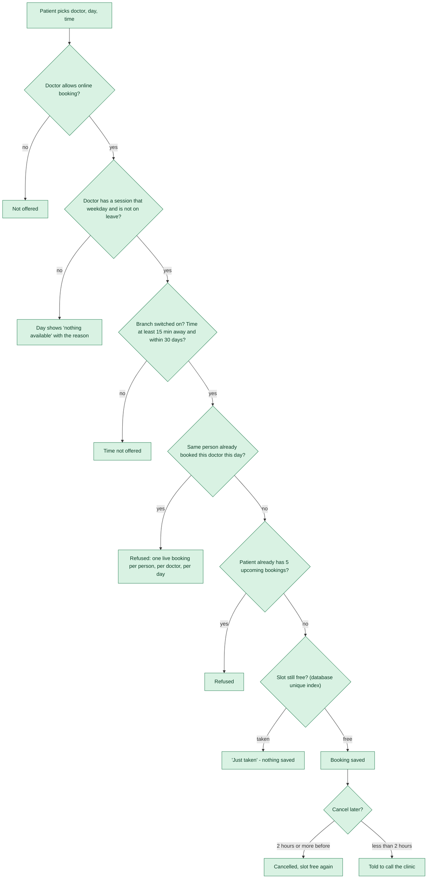
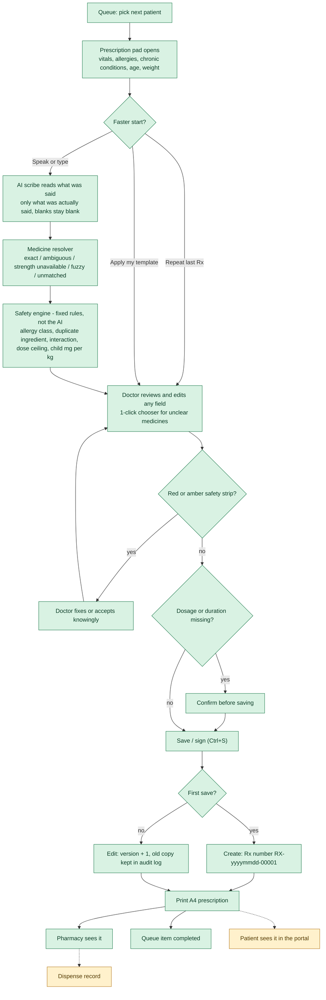
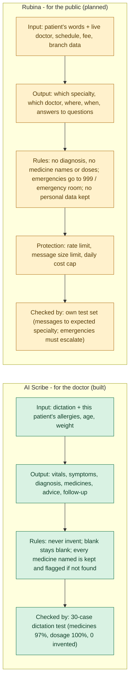
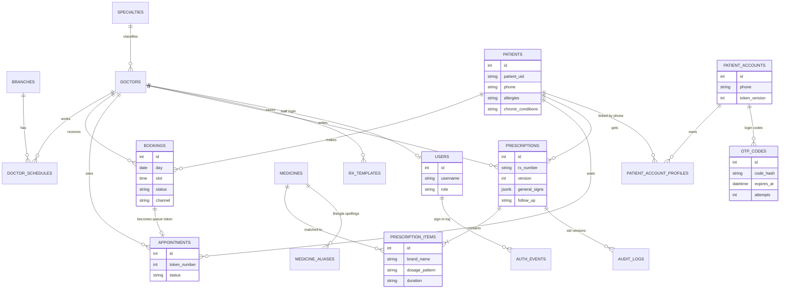
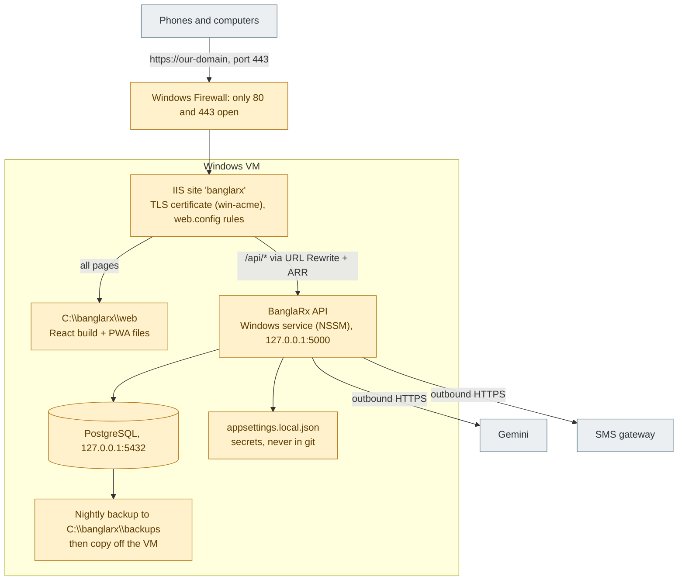
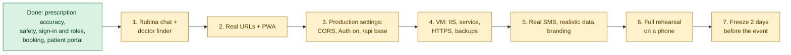

# BanglaRx AI - Application Flow Diagrams

Editable text diagrams (Mermaid). They draw automatically in GitHub, VS Code (Markdown preview
or the "Markdown Preview Mermaid Support" extension) and https://mermaid.live (paste a block to edit,
then copy it back). To change a diagram, edit the text inside its ```mermaid block.

Colour key used in every diagram:
- GREEN = built and working today
- AMBER = planned (not built yet)
- GREY  = outside service we connect to

Contents: 1 System map | 2 Who sees what | 3 Patient journey | 4 Phone-code login |
5 Booking rules | 6 Doctor consultation | 7 The two AIs | 8 Data model | 9 Deployment | 10 Release steps

---

## 1. System map (all parts and how they talk)



---

## 2. Who sees what (roles)



---

## 3. Patient journey (public chat to the consultation)



---

## 4. Phone-code login and finding the patient's old records



---

## 5. Booking rules (what the server checks)



---

## 6. Doctor consultation (prescription creation)



---

## 7. The two AIs (kept separate on purpose)



---

## 8. Data model (main tables)



Other tables: `app_secrets` (token signing key), `drug_interactions` and the medicine catalogue (currently 63 medicines, 15K planned).

---

## 9. Deployment (one Windows VM with IIS)



---

## 10. Build and release order



Details behind steps 3-7 are in `DEPLOYMENT_PLAN.md`. Day-to-day workflow rules are in `FULLSTACK_WORKFLOW.md`.
