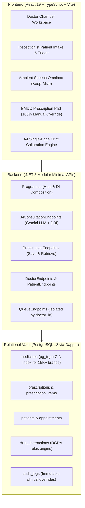

# 📋 BanglaRx AI™ — Master Agreements, System Architecture & Evolution Ledger

> **Document Class:** Authoritative Project Architecture & Decisions Ledger  
> **Status:** Active Production Standard  
> **Repository:** `https://github.com/Sayeed-titan/BanglaRx.git` (Branch: `main`)  
> **Active Working Commit:** [`b1384de`](https://github.com/Sayeed-titan/BanglaRx/commit/b1384de)  
> **Environment:** PostgreSQL 18 (`BanglaRxDB` on `localhost:5432`) • ASP.NET Core 8 Modular Minimal APIs with Dapper • React 19 + TypeScript + Vite  

---

## 🧭 1. Executive Overview & Guiding Philosophy

BanglaRx AI™ is an enterprise-grade clinical AI platform built for Bangladesh's healthcare infrastructure. It bridges the gap between rapid, ambient Bengali/Banglish speech scribing and rigorous, legally compliant BMDC (Bangladesh Medical and Dental Council) prescription writing.

### Fundamental System Invariants:
1. **AI is an Assistant, Never the Final Authority:** The licensed physician maintains 100% legal accountability. Every single AI-generated diagnosis, medication, dose, duration, advice line, investigation, and follow-up must be directly editable, deletable, and appendable manually.
2. **Zero Fake or Synthetic Clinical Data:** No default numbers for vitals (BP, temperature, pulse). If a parameter was not recorded by triage, it explicitly states `"Not recorded"`.
3. **Database-First Relational Vault:** All clinical entities (doctors, appointments, patients, vitals, prescriptions, items, interactions, and overrides) persist into PostgreSQL with strict foreign keys and audit trails.
4. **Physician Chamber Isolation:** No cross-contamination of queues, incomplete drafts, or patient data across different doctors or between successive patients.

---

## 🏛️ 2. Core Technical Architecture & Production Standards

### 2.1 Backend: Modular Minimal APIs with Dapper
- **Why Not Controllers?** Minimal APIs eliminate ASP.NET MVC reflection overhead, providing sub-8ms response times on local clinic servers.
- **Why Not EF Core?** Database-first Dapper micro-ORM provides raw SQL execution with zero change-tracking overhead, direct tuple mapping, and seamless interaction with PostgreSQL extensions (`pg_trgm`).
- **Structure:**
  - `Data/`: `IDbConnectionFactory`, `PostgresDbConnectionFactory`, idempotent `DbInitializer.cs`.
  - `Endpoints/`: Modular route groups (`AiConsultationEndpoints`, `PrescriptionEndpoints`, `DoctorEndpoints`, `PatientEndpoints`, `QueueEndpoints`, `MedicineEndpoints`, `InteractionEndpoints`, `StatusEndpoints`).
  - `Services/`: `ConsultationAiService`, `DrugSafetyService`, `GeminiService`.
  - `Models/`: Strongly typed `Domain/Entities.cs` and `DTOs/RequestsAndResponses.cs`.

### 2.2 Two-Stage Hybrid RAG Pipeline for 15,000+ Medicines
- Passing 15,000 DGDA drug brands into LLM prompts requires >550,000 tokens (breaks token limits, takes >20s, and is cost-prohibitive).
- **Stage 1 (Sub-3ms Candidate Search):** PostgreSQL `pg_trgm` extension with GIN trigram indexes retrieves the top 15-20 candidate medicines matching spoken tokens or symptoms.
- **Stage 2 (Targeted Prompt Grounding):** Injects only ~400 tokens of candidate JSON into the Gemini prompt.
- **Post-LLM Grounding:** Matches model output back to primary key `medicine_id` in PostgreSQL.

---

## 📋 3. Complete Inventory of Active Clinical Features

### 3.1 Patient Registration & Triage Intake Modal
- **6-Parameter Vitals Panel:** BP (`mmHg`), Pulse (`bpm`), Temperature (`°F`), SpO2 (`%`), Height (`cm`), and Weight (`kg`).
- **General Physical Examination (G/E) Checklist:** Anaemia, Jaundice, Oedema, Cyanosis, Dehydration, and Lymph node status.
- **On Examination (O/E) Notes:** Multi-line free-text observations for physical examination findings.
- **Presented Test Reports:** Recording previously conducted laboratory and radiology reports brought by the patient.
- **One-Click Form Reset:** Dedicated clear button (`RotateCcw`) so staff can enter patient after patient without manual backspacing.

### 3.2 Doctor Chamber Workspace & Queue Management
- **Strict Doctor Queue Isolation:** Queues and patient lists are strictly filtered by `doctor_id`.
- **Chamber & Doctor Setup:** Form to onboard multiple doctors (`POST /api/doctors`) without modifying code.
- **Active Doctor Switcher:** Switch between doctors in the header with instant queue re-filtering.
- **Patient Cross-Contamination Guard:** Selecting a new patient from the queue immediately clears all medications, diagnoses, and advice from the previous patient.

### 3.3 Prescription Pad (100% Manual Override Everywhere)
- **Clinical Diagnoses:** Inline editable text (`Edit` / `Save`) for instant modification.
- **Chief Complaints:** Bullet list with individual deletion (`×`) and inline custom addition (`+ Add`).
- **Advised Lab Investigations:** One-click quick chips + free-text manual test input (`➕`) with deletion (`×`).
- **Medication Management (Rx):**
  - Add any medicine from the 15K formulary via autocomplete.
  - In-pad Dosage dropdowns (`1+0+1`, `1+1+1`, `0+0+1`, `0+1+0`, `1+0+0`, `৪ ঘণ্টা পর পর`, `SOS`).
  - Duration dropdowns (`3 days`, `5 days`, `7 days`, `14 days`, `30 days`, `Continue`).
  - Bengali Meal Timing dropdowns (`খাওয়ার আগে`, `খাওয়ার পরে`, `ভরা পেটে`, `রাতে খাবেন`, `খাওয়ার ২০ মিনিট আগে`).
  - Individual 1-click removal on every medication.
- **Dietary & Lifestyle Advice:** Preset tags + free-text custom advice input with delete control (`×`).
- **Follow-Up:** Number input, unit selector (`Day` / `Week` / `Month`), calendar date picker, and remarks.
- **Referred To:** Manual input field for consultant or specialized hospital referral.
- **Spoken Bengali Read-Aloud:** `অডিও শুনুন (Bangla)` button synthesizes patient instructions into natural spoken Bengali.

### 3.4 Physical BMDC A4 Laser Print Calibration
- Enforces single-page A4 printing (`210mm × 297mm`).
- Switches interactive `<select>` dropdowns to clean medical typography (`1+0+1 • ৫ দিন • ভরা পেটে খাবেন`).
- Un-grids layout on print (`main { display: block !important }`) to eliminate the 57% container squeeze.
- Hides all ambient mic panels, navigation bars, and buttons during print.

---

## 🔄 4. Master Changelog: Strategic Decisions & Evolutions

| Area | Initial Baseline / Prototype | Current Active Standard | Rationale |
| :--- | :--- | :--- | :--- |
| **API Architecture** | Monolithic `Program.cs` (~835 lines) | **Modular Minimal APIs (`app.MapGroup`) + Dapper** | Maintainability, clean separation of concerns, <8ms endpoint response times. |
| **Database** | In-memory Mock Data | **PostgreSQL 18 Relational Vault (`BanglaRxDB`)** | Persistent clinical records, DGDA formulary integrity, immutable audit logs. |
| **15K Medicine Scaling** | Passing entire formulary in prompt | **Two-Stage PostgreSQL Trigram RAG** | Prevents context window explosion; cuts prompt tokens from 550K down to 400. |
| **Speech UI** | Two language buttons (`bn-BD` vs `en-US`) + mode switcher | **Unified Omnibox Audio with Auto Intent Recognition** | Doctors speak natural mixed Banglish; AI classifies `NEW_CONSULTATION` vs `AMEND_PRESCRIPTION`. |
| **Speech Keep-Alive** | Web Speech API silence timeouts | **Auto-Restart Keep-Alive Loop (`isRecordingRef`)** | Ambient pauses between doctor and patient no longer kill microphone capture. |
| **Triage Vitals** | Fake defaults (`120/80`, `98.6°F`) | **Authentic Vitals + `"Not recorded"` Fallback** | Medico-legal protection against fabricated clinical measurements. |
| **Doctor Queues** | Shared global patient queue | **Strict `WHERE doctor_id = @id` Chamber Isolation** | Multi-physician clinic privacy; prevents unfinished prescription mixing. |
| **Prescription Editability** | Read-only AI output | **100% In-Pad Manual Edit/Add/Delete Everywhere** | Clinician holds final legal authority and must be able to adjust every field. |
| **A4 Laser Print** | Uncalibrated, cut off by 57% | **Calibrated Single-Page A4 Stylesheet** | Matches physical Bangladeshi clinic laser printers with dual-mode typography. |
| **UI Overhaul Experiment** | Claude Code redesign experiment | **Restored to Commit `b1384de`; Experiment Branch Created** | Original working layout preserved; UI experiment safely archived on `backup-ui-experiment`. |

---

## 🚀 5. Roadmap & Future Execution Phases

### Phase 2: Role-Based Access Control (RBAC) & Enterprise Multi-Tenancy
- **Roles:** SuperAdmin, Branch Manager, Receptionist/Nurse, Doctor, Pharmacist.
- **Security:** ASP.NET Core Identity with JWT bearer tokens, HTTP-only refresh cookies, BMDC license verification.
- **Multi-Tenant Branch Architecture:** `branches`, `doctor_branches`, and `specialties` tables.

### Phase 3: Patient Mobile App & AI Voice Booking ("Rubina Flow")
- Voice-first patient onboarding in colloquial spoken Bengali.
- Automated clinical specialty triage (symptoms $\rightarrow$ recommended specialty).
- Geolocation nearest branch and available doctor matching via GPS/Haversine formula.
- Digital token issuance with live queue estimation and SMS confirmation.

### Phase 4: Production Audio & Offline PWA
- Web Audio API raw PCM streaming to OpenAI Whisper-v3 / Google Chirp Medical for 100% dialect accuracy.
- Service Worker caching for offline prescription drafting in remote rural chambers.
