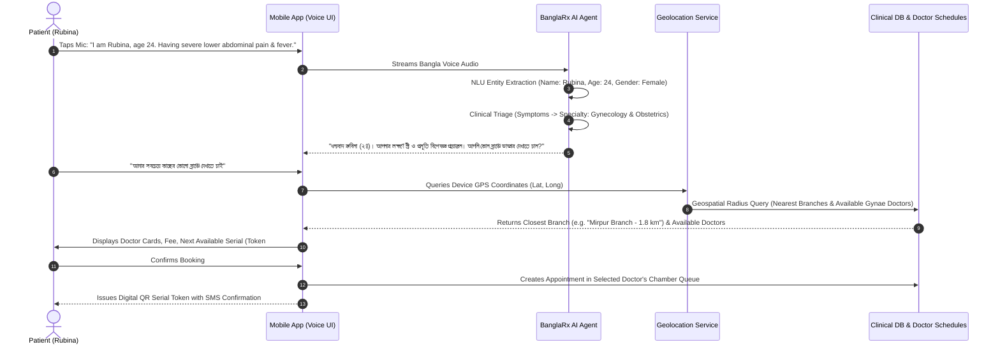

# 🏥 BanglaRx AI™ — Enterprise Clinical Platform Master Roadmap & TODO

> **Version:** 2.4.0-Architectural-Blueprint  
> **Status:** Active Execution (Web Application Core First $\rightarrow$ Business Logic $\rightarrow$ RBAC $\rightarrow$ Mobile App Ecosystem)  
> **Target Deployments:** Hospital Chains, Specialist Diagnostic Centers, Private Doctor Chambers, Patient Mobile App (iOS / Android)

---

## 🧭 Executive Vision & Architectural Strategy

BanglaRx AI™ is transitioning from an individual chamber ambient copilot into an enterprise-grade clinical ecosystem designed specifically for Bangladesh's healthcare infrastructure.

The roadmap follows a disciplined three-tier sequence:
1. **Phase 1: Web Application Clinical Business Logic (Current Focus)**  
   Solidify doctor chamber workflows, ambient consultation scribing, patient triage, BMDC-compliant prescription generation, drug safety verification, and queue management.
2. **Phase 2: Role-Based Access Control (RBAC) & Multi-Tenant Security**  
   Implement zero-trust security dividing permissions strictly across SuperAdmin, Branch Managers, Receptionists, Doctors, Pharmacists, and Patients.
3. **Phase 3: Patient Mobile App & AI Voice Registration ("Rubina Flow")**  
   Empower patients to book consultations via natural spoken Bangla, auto-triage symptoms to specialties, and locate the nearest branch via GPS / Map coordinates.
4. **Phase 4: Responsive Tablet & Mobile Experience**  
   Implement the design systems detailed in [RESPONSIVE_TODO.md](file:///d:/Departmental/R&D%20-%20MKL/BanglaRx/RESPONSIVE_TODO.md).

---

## 📋 Comprehensive Enterprise TODO Matrix

### 1. Web Application Core & Chamber Ergonomics (Current)
- [x] **BMDC Institutional Prescription Pad:**
  - Standard BMDC-format header, physician credentials, and patient demographics bar.
  - Split clinical columns: Clinical findings/vitals on left, Rx medications & instructions on right.
  - Advised investigations chip selector and patient-presented test reports history.
  - High-fidelity clean printing stylesheet (removes navigation, toolbars, and prompts).
- [x] **Patient Registration & Reception Triage Intake:**
  - **Clear / Reset Form Button:** One-click instant reset (`RotateCcw`) so receptionists can enter patient after patient without manual backspacing.
  - **Standardized Numeric Vitals Entry:** Eliminated manual unit typing. Dedicated numeric fields for BP (Systolic/Diastolic), Temperature, Pulse, and Weight with fixed suffix badges (`mmHg`, `°F`, `bpm`, `kg`).
  - Automatic JSONB serialization and chamber token generation.
- [x] **Inference Control & Abortability:**
  - Integrated `AbortController` in AI synthesis pipeline.
  - Dedicated **"Stop / Cancel Generation (বন্ধ করুন)"** button active during processing, allowing doctors to halt inference immediately without UI freezing.
- [x] **Ambient Continuous Speech Listening (Keep-Alive):**
  - Upgraded browser Web Speech API with an auto-restart keep-alive loop (`isRecordingRef`).
  - Speech pauses (silence timeouts) no longer terminate the microphone session prematurely.
  - Preserved accumulated transcript across automatic session restarts.
- [x] **Interactive In-Pad Rx Editing:**
  - Inline dosage pattern dropdowns (`1+0+1`, `1+1+1`, `0+0+1`, `1+0+0`).
  - Duration adjusters (`3 days`, `5 days`, `7 days`, `14 days`, `1 month`).
  - Bengali meal timing adjusters (`খাওয়ার আগে`, `খাওয়ার পরে`, `ভরা পেটে`, `ঘুমের আগে`).
- [ ] **Multi-Doctor Isolation in Web Interface:**
  - Ensure doctors only see their assigned appointments in the queue.
  - Filter patient lookup and prescriptions by the authenticated physician's practice scope.

---

### 2. Voice Scribing & Ambient Intelligence Upgrade
*Addressing current browser Web Speech API performance bottlenecks.*

- [ ] **Challenge with Web Speech API:**
  - Browser-dependent (requires Chrome/Edge).
  - Struggles with medical Banglish code-switching (e.g. *"patient-er fasting blood sugar nine point two mmol, Napa shathe add korben"*).
  - Silence timeouts require artificial keep-alive loops.
- [ ] **Next-Gen Production Audio Pipeline Architecture:**
  - **Frontend Audio Capture:** Replace Web Speech API with Web Audio API `AudioWorkletNode` streaming raw PCM 16kHz audio via WebSocket.
  - **Backend Speech-to-Text Microservice:**
    - Deploy **OpenAI Whisper-v3** or **Google Cloud Speech-to-Text v2 (Chirp Medical)** with custom Bengali medical vocabulary biasing.
    - Sub-500ms streaming latency with real-time word-level timestamps.
- [ ] **Ambient Multi-Party Diarization (Doctor + Patient + Staff):**
  - Implement acoustic speaker diarization separating audio into distinct speaker tracks:
    - `SPEAKER_01 (Doctor)`: Directives, diagnoses, medicine choices, advice.
    - `SPEAKER_02 (Patient)`: Symptoms, duration, history of present illness.
    - `SPEAKER_03 (Assistant/Nurse)`: Vitals readouts (*"Sir, BP 130 over 85, weight 68"*).
  - AI ambient listener automatically extracts clinical entities from the relevant speaker channel without manual prompt tagging.

---

### 3. Multi-Doctor, Multi-Specialty & Branch Infrastructure
- [ ] **Database Schema Expansion:**
  - `branches` table: `id`, `name`, `code`, `address`, `city`, `latitude`, `longitude`, `contact_number`, `is_active`.
  - `doctor_branches` table: Mapping doctors to multiple branches with day-wise schedules (`doctor_id`, `branch_id`, `days_of_week`, `start_time`, `end_time`, `room_number`).
  - `specialties` table: Standardized medical specialties (Cardiology, Pediatrics, Gynecology & Obstetrics, Medicine, Orthopedics, Dermatology, etc.).
- [ ] **Dynamic Branch & Chamber Selector:**
  - Doctors select their active branch upon logging in (e.g. *"Dhanmondi Branch — Room 302"*).
  - Queue drawer filters strictly for the selected doctor and active branch.

---

### 4. Patient Mobile App & AI Voice Registration ("Rubina Flow")
*Autonomous patient onboarding, intelligent symptom routing, and geolocation discovery.*



- [ ] **Mobile Voice Onboarding Assistant:**
  - Native Voice-First Interface in Bangla:
    *"আমি রুবিনা, বয়স ২৪, গত ২ দিন ধরে পেটে তীব্র ব্যথা আর জ্বর..."*
  - Extracted JSON Payload:
    ```json
    {
      "patientName": "Rubina",
      "age": 24,
      "gender": "Female",
      "chiefSymptoms": ["Severe lower abdominal pain", "Fever"],
      "recommendedSpecialty": "Gynecology & Obstetrics",
      "triageUrgency": "Medium-High"
    }
    ```
- [ ] **Intelligent Doctor Recommendation:**
  - Filters verified BMDC doctors by extracted specialty and chamber schedule.
- [ ] **Geolocation & Interactive Map Chamber Locator:**
  - PostGIS geospatial indexing or Haversine distance formula:
    $$d = 2r \arcsin\left(\sqrt{\sin^2\left(\frac{\Delta \phi}{2}\right) + \cos(\phi_1)\cos(\phi_2)\sin^2\left(\frac{\Delta \lambda}{2}\right)}\right)$$
  - Nearest branch locator if user speaks *"যেকোনো কাছের ব্রাঞ্চ"* (Any closest branch).
  - Interactive map view displaying clinic pins, travel distance, and parking availability.
- [ ] **Digital Token Issuance & Patient Wallet:**
  - Real-time estimated waiting time (e.g. *"Dr. currently seeing Token #2. Your turn in ~25 mins"*).
  - Push notifications when patient is 2 tokens away.
  - Digital prescription archive with offline viewing and medication dosage reminders.

---

### 5. Role-Based Access Control (RBAC) & Enterprise Security
*To be implemented immediately after core business logic sign-off.*

| Role | Access Permissions & Boundaries |
| :--- | :--- |
| **SuperAdmin** | Hospital group configuration, system audit logs, physician verification, global formulary updates. |
| **Branch Manager** | Branch schedule setup, chamber room allocation, staff shifts, appointment revenue reports. |
| **Receptionist / Nurse** | Patient intake, serial token issuance, triage vitals recording, queue sequence management. |
| **Doctor** | Active consultation workspace, ambient voice scribing, prescription generation, patient medical history. |
| **Pharmacist** | Prescription verification via QR scan, medication dispensing check, stock availability. |
| **Patient (Mobile)** | Profile management, voice symptom booking, digital Rx repository, follow-up scheduling. |

- [ ] **Authentication Architecture:**
  - ASP.NET Core Identity with JWT bearer tokens and HTTP-only encrypted refresh cookies.
  - BMDC license verification integration for physician accounts.
  - Multi-tenant data segregation ensuring clinics never access competitor patient data.

---

### 6. Responsive Tablet & Mobile Experience
- [ ] Complete implementation of [RESPONSIVE_TODO.md](file:///d:/Departmental/R&D%20-%20MKL/BanglaRx/RESPONSIVE_TODO.md) following business logic validation:
  - Mobile bottom navigation and quick consultation/Rx tab switcher.
  - Touch-friendly 44px+ controls and BMDC prescription responsive column stacking.
