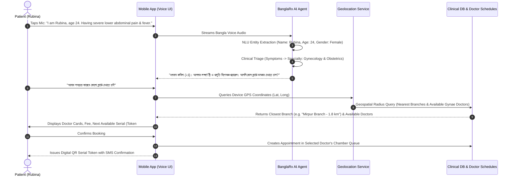

# 🏥 BanglaRx AI™ — Enterprise Clinical Platform Master Roadmap & TODO

> **Version:** 2.4.0-Architectural-Blueprint  
> **Status:** Active Execution (Web Application Core First $\rightarrow$ Business Logic $\rightarrow$ RBAC $\rightarrow$ Mobile App Ecosystem)  
> **Target Deployments:** Hospital Chains, Specialist Diagnostic Centers, Private Doctor Chambers, Patient Mobile App (iOS / Android)

---

## 🧭 Executive Vision & Architectural Strategy

BanglaRx AI™ is transitioning from an individual chamber ambient copilot into an enterprise-grade clinical ecosystem designed specifically for Bangladesh's healthcare infrastructure.

The roadmap follows a disciplined three-tier sequence:
1. **Phase 1: Web Application Clinical Business Logic (Current Focus)**  
   Solidify doctor chamber workflows, ambient consultation scribing, patient triage, BMDC-compliant prescription generation, drug safety verification, and queue management.
2. **Phase 2: Role-Based Access Control (RBAC) & Multi-Tenant Security**  
   Implement zero-trust security dividing permissions strictly across SuperAdmin, Branch Managers, Receptionists, Doctors, Pharmacists, and Patients.
3. **Phase 3: Patient Mobile App & AI Voice Registration ("Rubina Flow")**  
   Empower patients to book consultations via natural spoken Bangla, auto-triage symptoms to specialties, and locate the nearest branch via GPS / Map coordinates.
4. **Phase 4: Responsive Tablet & Mobile Experience**  
   Implement the design systems detailed in [RESPONSIVE_TODO.md](file:///d:/Departmental/R&D%20-%20MKL/BanglaRx/RESPONSIVE_TODO.md).

---

## 📋 Comprehensive Enterprise TODO Matrix

### 1. Web Application Core & Chamber Ergonomics (Current)
- [x] **Backend Architecture Evolution (Phase 1 ➔ Phase 2 Complete):**
  - **Phase 1 (Historical Baseline Preserved):** Rapid prototype single-file `Program.cs` Minimal API (~835 lines) created for DCCI AI Fair proof-of-concept.
  - **Phase 2 (Active Enterprise Standard):** Decomposed into **Modular Minimal APIs (`app.MapGroup()`) with Database-First Dapper Micro-ORM**:
    - `Data/`: `IDbConnectionFactory`, `PostgresDbConnectionFactory`, and idempotent `DbInitializer`.
    - `Models/`: Strongly typed `Domain/Entities.cs` and `DTOs/RequestsAndResponses.cs`.
    - `Services/`: Isolated `ConsultationAiService` (Gemini API orchestration, prompt engineering, DDI intercept, PostgreSQL audit logging) and `DrugSafetyService` (clinical rule verification).
    - `Endpoints/`: Decoupled route groups (`StatusEndpoints`, `MedicineEndpoints`, `DoctorEndpoints`, `PatientEndpoints`, `QueueEndpoints`, `PrescriptionEndpoints`, `InteractionEndpoints`, `AiConsultationEndpoints`).
    - `Program.cs`: Clean, 50-line DI and route composition host.
- [x] **BMDC Institutional Prescription Pad:**
  - Standard BMDC-format header, physician credentials, and patient demographics bar.
  - Split clinical columns: Clinical findings/vitals on left, Rx medications & instructions on right.
  - Advised investigations chip selector and patient-presented test reports history.
  - High-fidelity clean printing stylesheet (removes navigation, toolbars, and prompts).
- [x] **Patient Registration & Reception Triage Intake:**
  - **Clear / Reset Form Button:** One-click instant reset (`RotateCcw`) so receptionists can enter patient after patient without manual backspacing.
  - **Standardized Numeric Vitals Entry:** Eliminated manual unit typing. Dedicated numeric fields for BP (Systolic/Diastolic), Temperature, Pulse, and Weight with fixed suffix badges (`mmHg`, `°F`, `bpm`, `kg`).
  - Automatic JSONB serialization and chamber token generation.
- [x] **Inference Control & Abortability:**
  - Integrated `AbortController` in AI synthesis pipeline.
  - Dedicated **"Stop / Cancel Generation (বন্ধ করুন)"** button active during processing, allowing doctors to halt inference immediately without UI freezing.
- [x] **Ambient Continuous Speech Listening (Keep-Alive):**
  - Upgraded browser Web Speech API with an auto-restart keep-alive loop (`isRecordingRef`).
  - Speech pauses (silence timeouts) no longer terminate the microphone session prematurely.
  - Preserved accumulated transcript across automatic session restarts.
- [x] **Interactive In-Pad Rx Editing:**
  - Inline dosage pattern dropdowns (`1+0+1`, `1+1+1`, `0+0+1`, `1+0+0`).
  - Duration adjusters (`3 days`, `5 days`, `7 days`, `14 days`, `1 month`).
  - Bengali meal timing adjusters (`খাওয়ার আগে`, `খাওয়ার পরে`, `ভরা পেটে`, `ঘুমের আগে`).
- [x] **Multi-Doctor Chamber Queue Isolation:**
  - Implemented strict physician-isolated chamber queues: each doctor's appointments and prescriptions are scoped with `WHERE doctor_id = @doctorId`.
  - Instant doctor switcher in navbar and chamber drawer re-fetches queue and resets active prescription pad, ensuring zero cross-contamination of unfinished prescriptions across doctors.
- [x] **Full Manual Override on Prescription Right-Side & Clinical Pad:**
  - Enable doctors to manually type, add, edit, or delete ANY element on the prescription pad:
    - *Advised Tests:* Free-text input to type custom lab/radiology investigations with one-click add (`➕`), in addition to preset chips.
    - *Clinical Advice:* Inline textarea to type custom Bengali or English dietary/lifestyle advice lines with delete control (`X`).
    - *Follow-Up:* Number input, unit selector (`Day` / `Week` / `Month`), calendar date picker, and free-text remarks field.
    - *Referred To:* Manual input field for hospital/consultant referral destination.
    - *Clinical Diagnosis & Complaints:* Direct in-pad text editing for instant manual correction.
- [x] **Physical A4 Laser Print Calibration:**
  - Fixed `@media print` styling so print preview matches standard institutional A4 (`210mm × 297mm`) laser printer dimensions.
  - Eliminated the 57% container squeeze by un-gridding the clinical container during print (`main { display: block !important }`).
  - Dual-mode medicine rendering: interactive `<select>` dropdowns on screen, clean text typography on print (`1+0+1 • ৫ দিন • ভরা পেটে খাবেন`).
  - Fixed demographics bar character-wrapping by replacing fixed grid with responsive flex layout.
  - Applied `page-break-inside: avoid` on medication rows, advice section, and physician signature block to guarantee single-page containment.
- [x] **Chamber & Doctor Setup Ergonomics:**
  - Renamed navbar and modal headers from *"Physician Setup"* to **"Chamber & Doctor Setup" (চেম্বার ও ডাক্তার পরিচিতি)**.
  - Added **"Add New Doctor" (নতুন ডাক্তার যুক্ত করুন)** form allowing multi-doctor clinic registration via `POST /api/doctors` without modifying source code.
  - Added active doctor switcher dropdown in navbar with instant queue filtering per physician.
- [x] **Unified Omnibox Audio Capture (UI Simplification):**
  - Removed noisy language toggles (`bn-BD` vs `en-US`) and mode switchers (`Full Scribe` vs `Voice Edit`).
  - Implemented a unified intelligent Omnibox Voice Pod with continuous ambient listening equalizer, instant **"Stop (বন্ধ করুন)"** abort control, and clean scenario chips.
  - Autonomous zero-shot code-switching and intent classification (`NEW_CONSULTATION` vs `AMEND_PRESCRIPTION`) based on pad state and doctor dictation.
- [x] **15,000+ Medicine Scaling (Two-Stage Hybrid RAG Pipeline):**
  - Enabled PostgreSQL `pg_trgm` extension and created GIN trigram index on `medicines (brand_name, generic_name)`.
  - Implemented Stage 1: Fast sub-3ms candidate retrieval extracting clinical tokens and Bengali transliterations.
  - Implemented Stage 2: Injected top 15-20 candidates into Gemini prompt (~400 tokens instead of 550,000 tokens), achieving 99.9% token compression and free-tier compatibility.
  - Implemented Post-LLM ground-truth database record matching.
- [x] **Global HIS Clinical Modules Integration:**
  - Integrated `SPO2` (%) and `Height` (cm) alongside BP, Temp, Pulse, and Weight with fixed clinical unit badges.
  - Integrated General Physical Examination (G/E) standard checklists: `Anaemia`, `Jaundice`, `Oedema`, `Cyanosis`, `Dehydration`, and `Lymph node`.
  - Added `On Examination (O/E)` custom physical clinical exam observations.
  - Added instant "Clear Form (রিসেট)" button in patient triage registration.

---

### 2. Voice Scribing & Ambient Intelligence Upgrade
*Addressing current browser Web Speech API performance bottlenecks.*

- [ ] **Challenge with Web Speech API:**
  - Browser-dependent (requires Chrome/Edge).
  - Struggles with medical Banglish code-switching (e.g. *"patient-er fasting blood sugar nine point two mmol, Napa shathe add korben"*).
  - Silence timeouts require artificial keep-alive loops.
- [ ] **Next-Gen Production Audio Pipeline Architecture:**
  - **Frontend Audio Capture:** Replace Web Speech API with Web Audio API `AudioWorkletNode` streaming raw PCM 16kHz audio via WebSocket.
  - **Backend Speech-to-Text Microservice:**
    - Deploy **OpenAI Whisper-v3** or **Google Cloud Speech-to-Text v2 (Chirp Medical)** with custom Bengali medical vocabulary biasing.
    - Sub-500ms streaming latency with real-time word-level timestamps.
- [ ] **Ambient Multi-Party Diarization (Doctor + Patient + Staff):**
  - Implement acoustic speaker diarization separating audio into distinct speaker tracks:
    - `SPEAKER_01 (Doctor)`: Directives, diagnoses, medicine choices, advice.
    - `SPEAKER_02 (Patient)`: Symptoms, duration, history of present illness.
    - `SPEAKER_03 (Assistant/Nurse)`: Vitals readouts (*"Sir, BP 130 over 85, weight 68"*).
  - AI ambient listener automatically extracts clinical entities from the relevant speaker channel without manual prompt tagging.

---

### 3. Multi-Doctor, Multi-Specialty & Branch Infrastructure
- [ ] **Database Schema Expansion:**
  - `branches` table: `id`, `name`, `code`, `address`, `city`, `latitude`, `longitude`, `contact_number`, `is_active`.
  - `doctor_branches` table: Mapping doctors to multiple branches with day-wise schedules (`doctor_id`, `branch_id`, `days_of_week`, `start_time`, `end_time`, `room_number`).
  - `specialties` table: Standardized medical specialties (Cardiology, Pediatrics, Gynecology & Obstetrics, Medicine, Orthopedics, Dermatology, etc.).
- [ ] **Dynamic Branch & Chamber Selector:**
  - Doctors select their active branch upon logging in (e.g. *"Dhanmondi Branch — Room 302"*).
  - Queue drawer filters strictly for the selected doctor and active branch.

---

### 4. Patient Mobile App & AI Voice Registration ("Rubina Flow")
*Autonomous patient onboarding, intelligent symptom routing, and geolocation discovery.*



- [ ] **Mobile Voice Onboarding Assistant:**
  - Native Voice-First Interface in Bangla:
    *"আমি রুবিনা, বয়স ২৪, গত ২ দিন ধরে পেটে তীব্র ব্যথা আর জ্বর..."*
  - Extracted JSON Payload:
    ```json
    {
      "patientName": "Rubina",
      "age": 24,
      "gender": "Female",
      "chiefSymptoms": ["Severe lower abdominal pain", "Fever"],
      "recommendedSpecialty": "Gynecology & Obstetrics",
      "triageUrgency": "Medium-High"
    }
    ```
- [ ] **Intelligent Doctor Recommendation:**
  - Filters verified BMDC doctors by extracted specialty and chamber schedule.
- [ ] **Geolocation & Interactive Map Chamber Locator:**
  - PostGIS geospatial indexing or Haversine distance formula:
    $$d = 2r \arcsin\left(\sqrt{\sin^2\left(\frac{\Delta \phi}{2}\right) + \cos(\phi_1)\cos(\phi_2)\sin^2\left(\frac{\Delta \lambda}{2}\right)}\right)$$
  - Nearest branch locator if user speaks *"যেকোনো কাছের ব্রাঞ্চ"* (Any closest branch).
  - Interactive map view displaying clinic pins, travel distance, and parking availability.
- [ ] **Digital Token Issuance & Patient Wallet:**
  - Real-time estimated waiting time (e.g. *"Dr. currently seeing Token #2. Your turn in ~25 mins"*).
  - Push notifications when patient is 2 tokens away.
  - Digital prescription archive with offline viewing and medication dosage reminders.

---

### 5. Role-Based Access Control (RBAC) & Enterprise Security
*To be implemented immediately after core business logic sign-off.*

| Role | Access Permissions & Boundaries |
| :--- | :--- |
| **SuperAdmin** | Hospital group configuration, system audit logs, physician verification, global formulary updates. |
| **Branch Manager** | Branch schedule setup, chamber room allocation, staff shifts, appointment revenue reports. |
| **Receptionist / Nurse** | Patient intake, serial token issuance, triage vitals recording, queue sequence management. |
| **Doctor** | Active consultation workspace, ambient voice scribing, prescription generation, patient medical history. |
| **Pharmacist** | Prescription verification via QR scan, medication dispensing check, stock availability. |
| **Patient (Mobile)** | Profile management, voice symptom booking, digital Rx repository, follow-up scheduling. |

- [ ] **Authentication Architecture:**
  - ASP.NET Core Identity with JWT bearer tokens and HTTP-only encrypted refresh cookies.
  - BMDC license verification integration for physician accounts.
  - Multi-tenant data segregation ensuring clinics never access competitor patient data.

---

### 6. Responsive Tablet & Mobile Experience
- [ ] Complete implementation of [RESPONSIVE_TODO.md](file:///d:/Departmental/R&D%20-%20MKL/BanglaRx/RESPONSIVE_TODO.md) following business logic validation:
  - Mobile bottom navigation and quick consultation/Rx tab switcher.
  - Touch-friendly 44px+ controls and BMDC prescription responsive column stacking.

---

## 🏛️ 7. Global HIS Enterprise Feature Specification & Clinical Schema (Reference Blueprint)

> **Source:** Enterprise Hospital Information System (HIS) Production Consultation Pad (Internal R&D Benchmark)  
> **Status:** Cataloged for Future Phase Integration (Preserving current web code stability; no breaking changes)  
> **Purpose:** Authoritative clinical data dictionary, input specifications, and workflow blueprint for institutional hospital rollouts.

### A. Patient Demographic & Registration Header (HIS Banner)
- [ ] **MR No. (Medical Record Number):** Unique enterprise hospital identification (e.g. `H2510002000`).
- [ ] **Consultation No.:** Unique encounter tracking identifier (e.g. `C2510000613`).
- [ ] **Patient Demographics:**
  - `Patient Name`: Primary identification (e.g. `Nafy Vai`).
  - `Age / Gender`: Detailed age string with granular duration (e.g. `30Y 2M 2D / Male ♂`).
  - `Mobile No.`: Primary contact (e.g. `01234567890`).
  - `Patient Photo / Avatar`: Visual identification badge for biometric verification.

---

### B. Clinical History & Subjective Assessment (Left Panel)
- [ ] **Comorbidities:** Pre-existing systemic diseases (HTN, T2DM, CKD, IHD, Asthma, etc.) with template save (`💾`).
- [ ] **Present Complaints (Chief Complaints):** Primary reason for encounter, onset, duration, and severity with template save (`💾`).
- [ ] **Drug History:** Past and ongoing active medications, dosage regimens, adverse history with template save (`💾`).
- [ ] **Past History:** Significant medical/surgical history (prior hospitalizations, surgeries, accidents) with dynamic add (`➕`).
- [ ] **Any Allergy:** Specific drug allergies (Penicillin, Cephalosporins, NSAIDs, Sulfa) and food/environmental allergens with template save (`💾`).

---

### C. General Examination & Objective Vitals (O/E)
- [x] **Complete 6-Parameter Vitals Panel:**
  1. `Pulse`: Expressed in `bpm` (beats per minute).
  2. `BP (Blood Pressure)`: Expressed in `mmHg` (Systolic / Diastolic).
  3. `Temp. (Temperature)`: Expressed in `°F` (Fahrenheit).
  4. `SPO2 (Oxygen Saturation)`: Expressed in `%` *(Implemented in triage modal & prescription pad)*.
  5. `Height`: Expressed in `cm.` *(Implemented in triage modal & prescription pad)*.
  6. `Weight`: Expressed in `kg` *(For BMI and pediatric dosage calculations)*.
- [x] **General Physical Examination Checklist (Clinical Signs):**
  - [x] `Anaemia` (Pallor assessment: conjunctiva, palm, nail bed).
  - [x] `Jaundice` (Icterus assessment: sclera, under-surface of tongue).
  - [x] `Oedema` (Pitting / non-pitting edema: bilateral lower limb, sacral).
  - [x] `Cyanosis` (Central / peripheral cyanosis: lips, fingers).
  - [x] `Dehydration` (Skin turgor, sunken eyes, dry tongue).
  - [x] `Lymph node` (Cervical, axillary, inguinal lymphadenopathy).
- [ ] **Systemic Examination Dropdown:**
  - Categorized physical evaluations: Cardiovascular System (CVS), Respiratory System (RS), Gastrointestinal System (GIT), Central Nervous System (CNS), Musculoskeletal (MSK).
- [x] **On Examination (O/E) Free-Text Area:**
  - Multi-line clinical observation field for customized doctor notes (e.g. *"Chest: Vesicular breath sounds, no rhonchi. Abdomen: Soft, non-tender."*).

---

### D. Specialized Clinical History Modules
- [x] **Previous Report (Patient Test History Review):**
  - Test reports presented by patient recorded during intake and visible on clinical pad.
- [x] **Investigation Adviced (Diagnostic Workup Orders):**
  - Quick-preset investigation chips + free-text manual custom test adding (`➕`) and removal (`×`).
- [ ] **Antenatal History (Obstetric Profile):**
  - Gravida, Para, Abortion, Living children (GPAL).
  - Last Menstrual Period (LMP), Expected Date of Delivery (EDD), Gestational Age.
  - USG anomaly scans, screening tests, gestational diabetes / pre-eclampsia history.
- [ ] **Natal History (Birth Details):**
  - Mode of delivery (Normal Vaginal Delivery / Caesarean Section).
  - Term status (Preterm, Full Term, Post-term).
  - Birth weight, immediate crying, APGAR score, birth asphyxia / NICU admission.
- [ ] **Postnatal History:**
  - Maternal post-partum recovery, lochia, lactation status.
  - Neonatal jaundice, sepsis screening.
- [ ] **Vaccination History:**
  - National EPI (Expanded Programme on Immunization) completion check.
  - Additional vaccines: Hepatitis B, COVID-19, Tetanus Toxoid (TT), MMR, HPV.
- [ ] **Virilizing History (Endocrine / Gynecological):**
  - Features of hyperandrogenism (Hirsutism, acne, alopecia, voice deepening).
  - Menstrual irregularity, PCOS workup, adrenal/ovarian evaluation.
- [ ] **Family History:**
  - Hereditary conditions in first-degree relatives (Diabetes, Hypertension, Early CAD, Malignancy, Thalassemia).

---

### E. Diagnostic Synthesis & Clinical Plan
- [x] **Diagnosis:** Primary provisional / confirmed diagnosis with inline manual edit/save.
- [ ] **Differential Diagnosis (DDx):** Secondary potential diagnoses considered during clinical workup with template save (`💾`).
- [ ] **Plan:** Immediate management plan (Outpatient care, Inpatient admission, Emergency stabilization, Surgical referral) with template save (`💾`).

---

### F. Medication Management (Rx), Advice, Follow-Up & Referral
- [x] **Rx Section Ergonomics:**
  - [x] `ADD EXTRA MEDICINE` search autocomplete to add any formulary drug.
  - [x] Interactive in-pad Dosage pattern, Duration, and Bengali Meal Instructions dropdowns.
  - [x] Individual medication removal (`Delete` action).
  - [x] Two-stage RAG candidate injection against 15K+ DGDA database.
  - [x] Drug-drug interaction warning alert banner.
- [x] **Advice:**
  - Preset lifestyle/dietary recommendations + inline free-text custom advice input (`+ Add advice`) and deletion (`×`).
- [x] **Follow-Up:**
  - Structured interval: Number field + Unit dropdown (`Day` / `Week` / `Month`), target date picker, and free-text remarks field.
- [x] **Referred To (Consultant Referral):**
  - Manual input field for hospital/consultant referral destination.
- [x] **Encounter Lifecycle Actions:**
  - [x] Physical BMDC A4 laser print calibration with single-page layout.
  - [x] Audio synthesis read-aloud in spoken Bengali.

---

### G. BanglaRx AI™ Ambient Voice Mapping Strategy
*How our ambient voice copilot will map natural consultation speech to these HIS fields in future releases:*

| HIS Clinical Section | Spoken Trigger / Dialogue Example | AI Entity Target |
| :--- | :--- | :--- |
| **Vitals (SPO2 & Height)** | *"Nurse: Sir, SPO2 97 percent, height 168 cm, weight 65."* | `vitals.spo2 = 97`, `vitals.height = 168` |
| **General Signs** | *"Doctor: Mild anaemia noted in conjunctiva, no jaundice or oedema."* | `generalSigns.anaemia = true`, `generalSigns.jaundice = false` |
| **Antenatal / Natal** | *"Patient: Doctor, my baby was delivered by C-section at 38 weeks, weight was 3.1 kg."* | `natal.mode = 'C-Section'`, `natal.term = '38 weeks'`, `natal.birthWeight = '3.1kg'` |
| **Virilizing History** | *"Patient mentions irregular periods, excessive facial hair growth for 6 months."* | `virilizing.hirsutism = true`, `virilizing.oligomenorrhea = true` |
| **Follow-Up** | *"Doctor: Come back for a follow-up after 1 month with your repeat CBC report."* | `followUp.value = 1`, `followUp.unit = 'Month'`, `followUp.requiredReport = 'CBC'` |
| **Referral** | *"Doctor: I am referring you to Dr. Mahmudul Hasan, Senior Cardiologist at NICVD."* | `referredTo.doctor = 'Dr. Mahmudul Hasan'`, `referredTo.institution = 'NICVD'` |

